  

  

  
  
  
  

---

## 🚀 About Me

  

I'm an AI Developer at DataToBiz. I build LLM systems that are **measured, not guessed**: every change to a prompt or model goes through an evaluation harness before it ships.

- 🎓 MSc Data Science, Savitribai Phule Pune University (CGPA 9.64)
- 🎓 BSc Statistics, Modern College Pune (CGPA 8.65)

---

## 💼 Experience

**🟢 AI Developer · DataToBiz Pvt. Ltd. (PrepAI, EdTech)** · *Sep 2026 – Present*
- Built a GPT-4o-mini descriptive-answer grading system and raised accuracy from **88% → 97%** on a 35-case benchmark across 8 subjects
- Diagnosed false-positive grades through LLM output analysis, then added evidence-quoting and code-level scoring rules
- Created an evaluation harness tracking accuracy, over/under-marking and run-to-run variance
- Built YouTube transcript ingestion with language filtering and error classification (**2.5s median latency**)
- Delivered provider-agnostic speech-to-text for audio question generation and fixed 5 production defects

**AI Intern · DataToBiz Pvt. Ltd. (Rider Behaviour & Emotion Analysis)** · *Apr 2026 – Sep 2026*
- Annotated and validated **30,000+ video segments** for automotive computer vision datasets
- Trained DeepFace for emotion recognition and XGBoost for rider behaviour classification

**Data Specialist Intern · SkillReigns Technologies** · *Feb 2025 – Apr 2025*
- Data cleaning, feature engineering, and model training and evaluation

---

## 🛠️ Tech Stack

  

  
  
  
  
  
  
  
  
  
  
  

---

## 📂 Featured Projects

<table>
<tr>
<td width="33%" valign="top">

### 📘 [ExamForge](https://github.com/atjibraan/YOUR-EXAMFORGE-REPO)
RAG exam-prep engine with cross-encoder reranking, corrective re-retrieval and LLM-as-judge scoring. Three-tier model routing; handles 15 table-of-contents layouts.

`LangChain` `FAISS` `Ollama` `Gemini`

</td>
<td width="33%" valign="top">

### 🏗️ [Crack Detection](https://github.com/atjibraan/YOUR-CRACK-DETECTION-REPO)
Real-time crack detection and severity classification. **93% accuracy, 85% mAP**. Live on Hugging Face Spaces.

`YOLOv5` `ResNet-18` `Streamlit`

</td>
<td width="33%" valign="top">

### 🎨 [Text-to-Image](https://github.com/atjibraan/YOUR-TEXT-TO-IMAGE-REPO)
Customizable Stable Diffusion pipeline with configurable inference settings and a Gradio UI.

`Stable Diffusion` `PyTorch` `Diffusers`

</td>
</tr>
</table>

---

## 📊 GitHub Activity

  
  

<!-- Snake eating contributions (needs the snake.yml workflow) -->

  <picture>
    <source media="(prefers-color-scheme: dark)" srcset="https://raw.githubusercontent.com/atjibraan/atjibraan/output/github-snake-dark.svg" />
    
  </picture>

